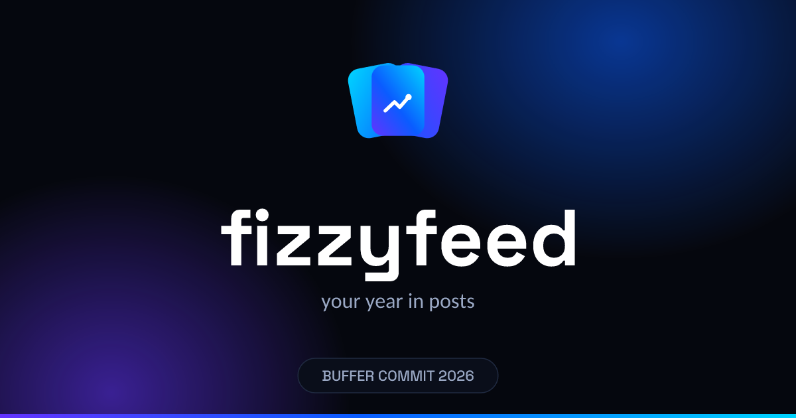

# fizzyfeed — brand kit

**Electric Blue identity · your year in posts.**
Built for **Buffer Commit 2026** ($25,600 hackathon, Oct 28 – Nov 13).



> **What are we building?** Read [`IDEA.md`](IDEA.md) — the full product concept: the flow, the 7 story-card chapters, the auto-queued recap post, and the stack.

## Name status

| Role | Name | Domain | State |
|---|---|---|---|
| Dev codename | `kroma` | kroma-ai.xyz (owned) | ✅ active — used during development |
| Final candidate A | `fizzyfeed` | fizzyfeed.cv (~$7.98/yr) | ⏳ pending purchase decision |
| Final candidate B | `feezyfeed` | feezyfeed.cv | ⏳ pending |

**The mark is name-agnostic by design** — it encodes the product (a fanned deck of story cards carrying your year), not a word. Swap the wordmark whenever the name lands; the Deck never changes.

## The mark — "The Deck"

- **Three fanned gradient cards** → the story deck your year becomes — one card per moment; volt & violet flanks bookend the electric blue core
- **White yearline spark on the front card** → the recap moment the whole year rises toward
- **Chroma sweep on the front card** → nods to the `kroma` codename

Files: `logo/svg/mark-gradient.svg` (primary), `mark-glyph-dark.svg` / `mark-glyph-light.svg` (mono deck silhouette), `favicon.svg` (cards only, no spark — cleaner at 16px).

Wordmarks & lockups (vector-outlined, font-independent): `logo/svg/wordmark-{name}-{on-dark|on-light}.svg`, `lockup-{name}-{on-dark|on-light}.svg` — pre-built for **kroma / fizzyfeed / feezyfeed** so the rename is a file swap, not a redesign.

## Palette

| Token | Hex | Use |
|---|---|---|
| `electric-500` | `#0A5CFF` | **Primary** — buttons, links, focus, brand moments |
| `electric-600` | `#0047E0` | Small text on white (AA-safe) |
| `volt-500` | `#00D5FF` | Gradient tail, live/active accents on dark |
| `violet-500` | `#6333FF` | Gradient head, secondary charts |
| `spark-500` | `#C8FF4D` | Delight accent — sparingly (≤5% of any screen) |
| `ink-950` | `#05070E` | App background (dark-first) |
| `ink-300` | `#9AA8C4` | Secondary text on dark |

Full scales, 7 recap-card gradients, radii, glows → `tokens.css` / `tokens.json`.

## Typography

| Role | Font | Notes |
|---|---|---|
| Display / wordmark | **Space Grotesk** 500/700 | lowercase headlines, -1% tracking feel |
| UI / body | **Inter** 400/500/600 | sentence case |
| Stats / numbers | **JetBrains Mono** 500 | tabular data, streaks, counts |

## Quick use

```html
<link rel="stylesheet" href="tokens.css">
<!-- or Tailwind v4 -->
<style>
  @theme {
    --color-electric-500: #0A5CFF;
    --color-ink-950: #05070E;
    --font-display: "Space Grotesk", sans-serif;
  }
</style>
```

## Social & OG assets

| File | Size | Use |
|---|---|---|
| `social/og-image.png` | 1200×630 | default OG (name-agnostic) |
| `social/og-image-kroma.png` / `-fizzyfeed.png` | 1200×630 | named variants |
| `social/github-social-preview.png` | 1280×640 | repo Settings → Social preview |
| `social/twitter-banner.png` | 1500×500 | X/Twitter header |
| `logo/png/avatar-400.png` | 400×400 | GitHub/X avatar |

Source `.svg` masters sit next to every PNG — edit those, re-render.

## Preview

Open `preview/index.html` in a browser — full brand board: logo variants, clearspace, palette, card gradients, type specimen, usage do/don'ts.

## Landing page (motion-first)

`landing/index.html` — dark-first marketing page with six seamless animation modules
(hero deck, feed-to-deck homage, chapter fan, yearline stats, alter-ego morph, recap CTA).
Serve locally with `npx serve landing/`. Each module is self-contained in
`landing/animations/<id>/index.html`; motion law lives in [`docs/ANIMATIONS.md`](docs/ANIMATIONS.md).

## Agent-native repo

This codebase is built to be worked on by AI agents (and humans):

- **[`AGENTS.md`](AGENTS.md)** — the operating manual: read order, non-negotiables, workflow protocol, definition of done.
- **[`docs/specs/`](docs/specs/)** — the build specs (00 product → 08 build plan) for the app itself: architecture, D1 schema, Buffer OAuth PKCE, yearize pipeline, satori deck rendering, AI persona, recap queue, Greatest Hits.
- **[`tasks/TASKS.json`](tasks/TASKS.json)** — machine-readable task queue; agents claim → build → verify → close.
- **`scripts/agent-check.sh`** — guardrails (banned word, name-agnosticism, token discipline, secrets); run before every commit.
- **Skills in-repo**: impeccable (`.claude/skills/`), ponytail, graphify, vercel web-design-guidelines + react-best-practices (`skills/`).
- Multi-agent harness files: `CLAUDE.md`, `.cursor/rules/`, `.github/copilot-instructions.md`.


## Rules of thumb

1. Dark-first: `ink-950` background, electric blue as the light source.
2. One gradient per screen section — the chroma sweep is a highlight, not wallpaper.
3. Never recolor the yearline spark or the card gradients; the deck wears its three fixed gradients only.
4. Don't use the word "wrapped" anywhere in UI or copy (trademark).
5. Min sizes: mark 24px, glyph 20px, lockup height 32px.

## License & attribution

© 2026 — brand assets for this project. "Buffer" is a trademark of Buffer Inc.; this kit references the Buffer Commit contest but grants no rights to Buffer's name or logo.
